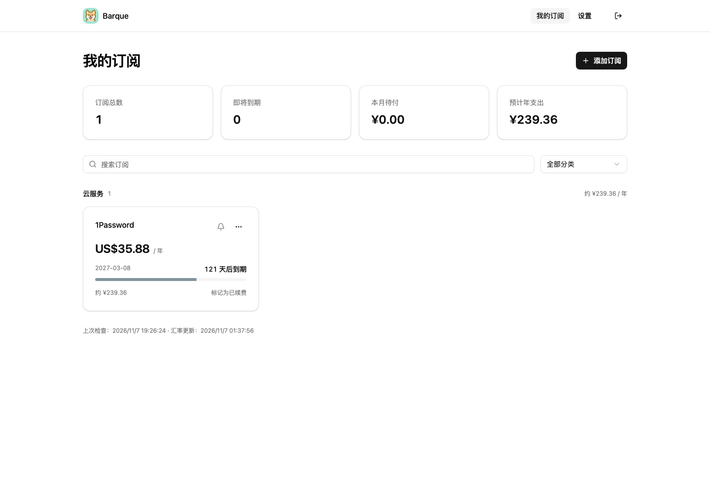
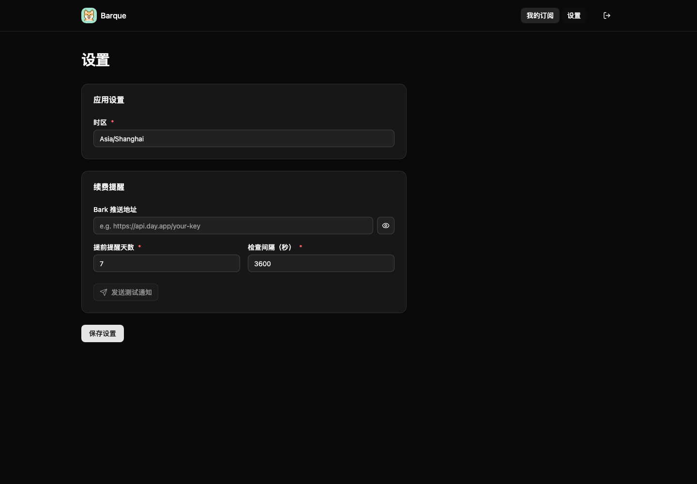

<p align="center">
  
</p>

# Barque

订阅提醒工具，在到期前通过 Bark 自动向 iPhone 推送通知。

在网页中管理订阅和提醒设置，数据保存在 SQLite 中，无需编辑配置文件。整个界面使用 shadcn/ui 默认样式，明暗外观始终跟随系统。

## 截图





## 快速开始

```shell
git clone https://github.com/qvshuo/Barque.git --depth=1
cd Barque
cp docker-compose.example.yml docker-compose.yml
# 编辑 docker-compose.yml，将 BARQUE_PASSWORD 改为自己的访问密码
# 示例密码为 123456，密码长度为 6–256 个字符
docker compose up -d --build
```

打开 `http://localhost:8080`，输入 Compose 中配置的密码，无需用户名。项目仅提供 Docker Compose 部署示例，实际的 `docker-compose.yml` 不纳入版本管理。

- **我的订阅**：管理、搜索和筛选订阅。进度条以雾蓝表示正常、赭金表示即将到期、陶红表示今天到期、鼠尾草绿表示已续费。点击卡片底部右侧「标记为已续费」后，显示「✓ 本期已续费」，本期不再提醒；再次点击可撤销，下一账期自动恢复。点击铃铛可以切换长期提醒开关，也可以在编辑表单中设置，两者同步。
- **设置**：配置时区、Bark 推送地址和提醒检查频率。提前提醒默认 7 天，提醒时间默认按配置时区的 09:00，后台默认每小时检查一次；汇率每天更新，失败后在下一轮检查重试。网页在前台每分钟、返回前台时刷新。设置保存后立即生效，未保存时切换页面或关闭标签页会提示确认。
- **外观**：shadcn/ui 默认样式，自动跟随系统明暗模式。

所有数据和操作均需登录。密码只在 Compose 的 `BARQUE_PASSWORD` 中配置，网页不提供设置或修改入口。修改后执行 `docker compose up -d` 重建容器，新密码生效并撤销已有会话；密码未变化时，7 天有效期内的登录会话在重启后保留。密码以 scrypt 哈希保存。

设置页可导出 JSON 配置，并通过导入覆盖应用设置和订阅。导出包含 Bark 推送地址，不包含 Compose 访问密码；续费标记、通知记录与汇率缓存不包含在导出文件中。相同订阅及账期的本地续费标记在导入后保留。

站点名称固定为 Barque。可配置项与内部固定行为见 [配置说明](docs/configuration.md)。

## 数据与升级

所有配置、订阅、续费状态、通知去重记录和汇率缓存均保存在 `/app/data/barque.sqlite3`。Compose 默认将 `./data` 挂载到 `/app/data`。备份时先停止容器，再备份整个 `data` 目录，以同时包含 SQLite 的 WAL 文件。

已有版本升级时，保留原来的 `data` 挂载，再执行：

```shell
docker compose up -d --build --pull always
```

首次启动发现 `data/subscriptions.toml` 时，会在一个事务中导入原配置、订阅以及旧 JSON 中的续费状态、通知记录和汇率缓存。原文件保留；导入成功后不再读取它们，后续设置统一在首页的「设置」中修改。导入失败时会回滚并记录错误，修复原数据后重新启动即可。`BARQUE_CONFIG` 已移除，`BARQUE_DATA_DIR` 仍可用于指定数据目录。

## 构建

运行时使用 Python 3.15.2，静态构建使用 Node.js 26.13.0。依赖版本记录在 `requirements.txt` 和 `frontend/package-lock.json`。Docker 多阶段构建中使用 React、shadcn/ui、Tailwind CSS、esbuild，无需 Vite；运行镜像仅包含 Python 服务与编译后的静态文件。JS/CSS 在构建时最小化并预生成 gzip，按浏览器能力协商传输；带内容哈希的资源使用一年不可变缓存。

shadcn/ui 组件源码和默认主题位于 `frontend/src/components/ui`、`frontend/src/index.css` 和 `frontend/src/shadcn.css`；许可证见 `frontend/SHADCN-LICENSE`。

## 测试

后端测试无需访问外部服务：

```shell
python -m unittest discover -s tests -v
npm --prefix frontend run build
```

浏览器测试在一个独立的测试实例上运行，会创建、修改和清理测试订阅，并临时修改后恢复应用设置：

```shell
cd frontend
npx playwright install chromium
BARQUE_TEST_URL=http://localhost:8080 BARQUE_TEST_PASSWORD=123456 npm test
```
